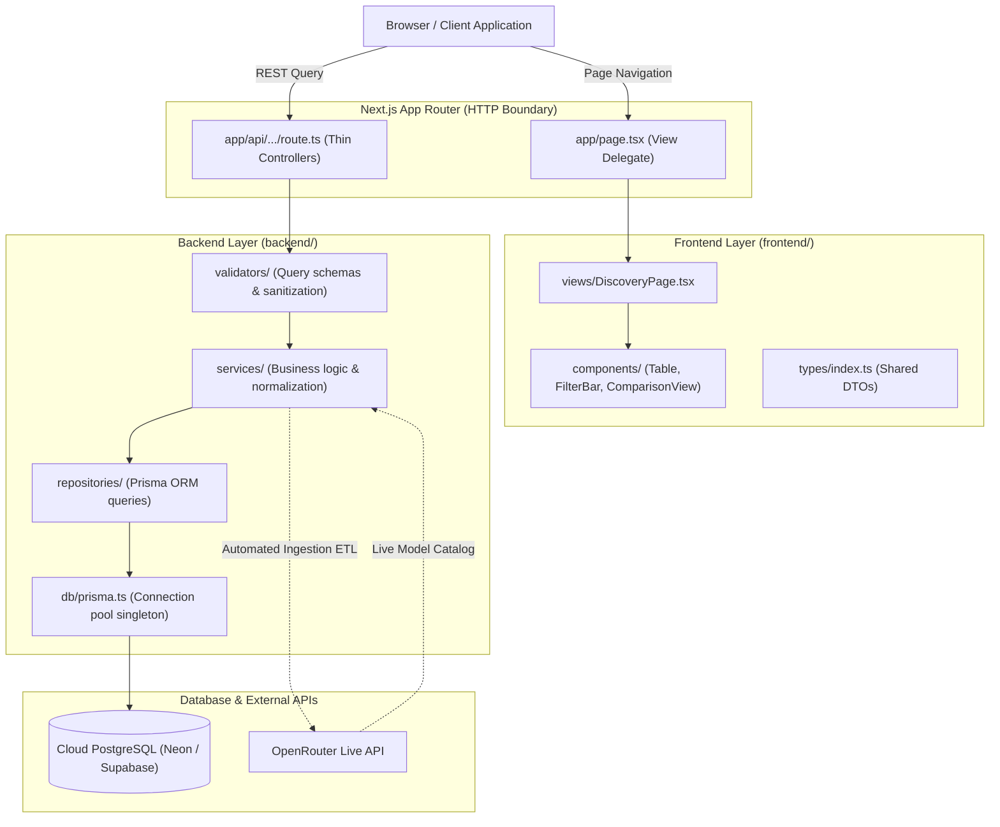
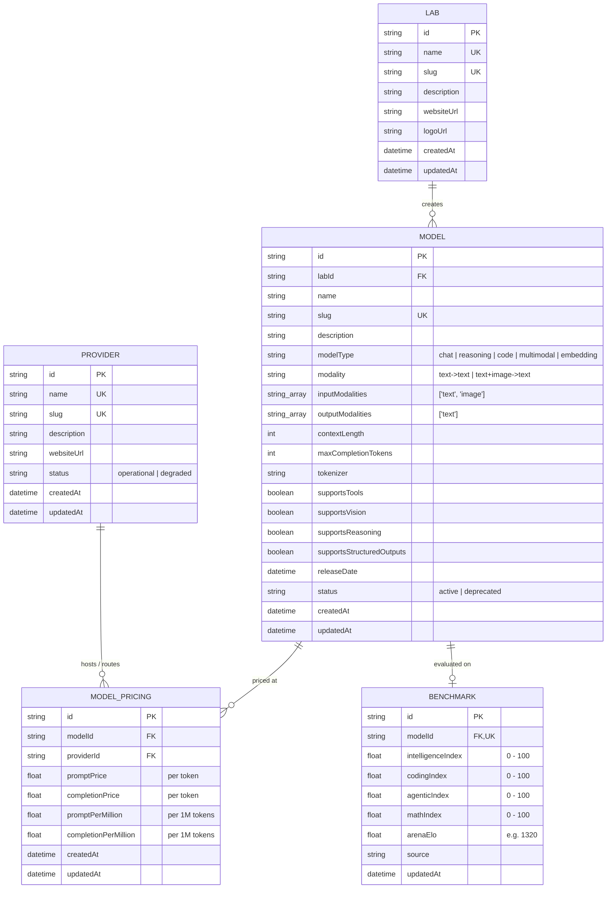
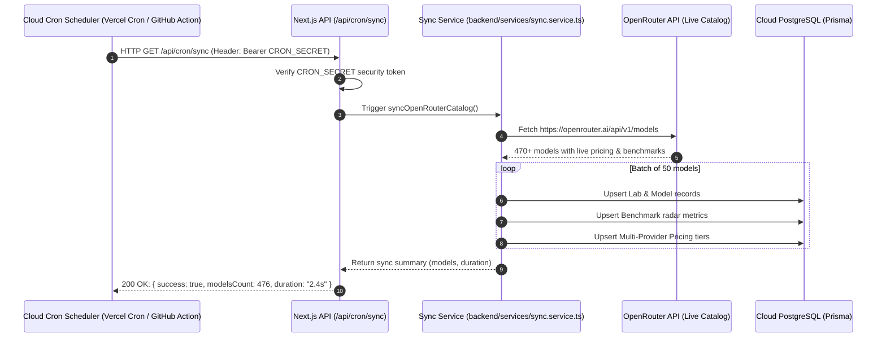

# ONEATLAS.DEV — AI Model Discovery & Intelligence Platform

[](https://nextjs.org/)
[](https://www.typescriptlang.org/)
[](https://www.prisma.io/)
[](https://www.postgresql.org/)
[](https://tailwindcss.com/)
[](https://openrouter.ai/)

> **Live Product:** [https://oneatlas.dev/](https://oneatlas.dev/)  
> **Platform Mission:** A developer-first, unified intelligence platform to discover, evaluate, compare, and benchmark foundation AI models across research labs and inference providers.

---

## 1. Product Vision & Problem Statement

As foundation model releases accelerate, developers, AI engineers, and software architects face critical fragmentation across three core dimensions:

1. **Pricing Discrepancies**: The same underlying architecture (e.g., Llama 3.3 70B, DeepSeek-R1, Mistral Large) is hosted by multiple providers with widely divergent input/output pricing, token limits, and throughput tiers.
2. **Evaluation Complexity**: Disparate benchmarks (Artificial Analysis Intelligence Index, LMSYS Arena Elo, Coding Index, Math scores) are scattered across fragmented leaderboards.
3. **Creator vs. Host Disconnect**: Distinguishing the *research organization* that created the model (e.g., Anthropic, DeepSeek, Google DeepMind, Meta) from the *infrastructure host* (e.g., OpenRouter, Groq, Together AI, Azure) is often blurred.

**OneAtlas** solves this by unifying 470+ models into a single, real-time intelligence catalog with relational multi-provider pricing, capability filtering, side-by-side spec comparison, and benchmark rankings.

---

## 2. Reference Platforms & Architectural Inspiration

OneAtlas synthesizes key design strengths from three leading developer platforms:

```
┌─────────────────────────────────────────────────────────────────────────────┐
│                              ONEATLAS.DEV                                   │
├───────────────────┬─────────────────────────┬───────────────────────────────┤
│ From OpenRouter   │ From RouterPlus         │ From LiteLLM                  │
├───────────────────┼─────────────────────────┼───────────────────────────────┤
│ • Real-time live  │ • Side-by-side feature  │ • Supported parameters        │
│   pricing & tokens│   diff highlighting     │   (tools, json, reasoning)   │
│ • Host/Router     │ • Evaluation matrix &   │ • Provider compatibility &    │
│   ecosystem       │   benchmark scorecards  │   model alias mapping         │
└───────────────────┴─────────────────────────┴───────────────────────────────┘
```

---

## 3. Core Platform Capabilities

### 🔍 Multi-Facet Model Discovery & Search
- **Full-Text Search**: Case-insensitive partial matching across model name, slug, description, and creator lab.
- **Model Category Filtering**: Filter by `chat`, `reasoning` (thinking models), `code` specialists, or `multimodal` vision models.
- **Capability Flags**: Filter models by hardware/software features:
  - Function Calling / Tool Use (`supportsTools`)
  - Vision & Multimodal Understanding (`supportsVision`)
  - Extended Chain-of-Thought Reasoning (`supportsReasoning`)
  - Structured JSON Schema Outputs (`supportsStructuredOutputs`)
- **Multi-Parameter Sorting**: Sort dynamically by Artificial Analysis Intelligence Score, lowest input price per million tokens, context window size, or release date.
- **Server-Side Pagination**: Scalable offset pagination with total page math and limit clamping.

### ⚖️ Side-by-Side Model Comparison Studio
- Evaluate **2 to 4 models simultaneously** in a structured matrix.
- **Automatic Winner Calculations**:
  - Lowest Input Cost winner
  - Lowest Output Cost winner
  - Largest Context Window winner
  - Highest Intelligence Benchmark winner
  - Highest Coding Index winner
- **Capabilities Matrix**: Visual checkmarks indicating support for function calling, vision, and reasoning effort.

### 🏆 Benchmark Leaderboards & Rankings
- Comprehensive leaderboards ranked by:
  - **Intelligence Index**: Composite Artificial Analysis benchmark (0–100 scale).
  - **Coding Index**: Programming & syntax generation scores.
  - **Agentic Index**: Multi-step tool-use and autonomy rating.
  - **Value-for-Money Score**: Custom economic metric evaluating Intelligence Points per Dollar of input pricing.

### 🏢 AI Research Labs & Inference Providers Directory
- **AI Research Labs**: Directory of foundation model creators (OpenAI, Anthropic, DeepSeek, Meta AI, Google DeepMind, Mistral AI, Cohere, xAI) with model counts and flagship architectures.
- **Inference Providers**: Directory of inference hosts (OpenRouter, Groq, Together AI) tracking active operational status and pricing minimums.

---

## 4. System Architecture & Separation of Concerns

The codebase enforces a strict **Clean Architecture**, completely decoupling frontend presentation components from backend business logic, repositories, and data storage:



### Modular Directory Structure

```text
OneAtlas/
├── backend/                         # SERVER-SIDE DOMAIN & DATA ENGINE
│   ├── db/
│   │   └── prisma.ts                # Prisma Client singleton with connection pooling
│   ├── repositories/                # Direct database access layer
│   │   ├── model.repository.ts      # Multi-facet search, filtering & pagination
│   │   ├── lab.repository.ts        # AI Lab directory queries & aggregates
│   │   └── provider.repository.ts   # Inference provider queries
│   ├── services/                    # Business logic & calculations
│   │   ├── model.service.ts         # Normalization, pricing math, model detail
│   │   ├── compare.service.ts       # Side-by-side evaluation matrix & winners
│   │   ├── rankings.service.ts      # Leaderboard & value-for-money index
│   │   ├── lab.service.ts           # Research labs & flagship model computation
│   │   ├── provider.service.ts      # Inference host catalogs & pricing ranges
│   │   └── sync.service.ts          # OpenRouter live ETL ingestion pipeline
│   ├── validators/                  # Request schema validation & sanitization
│   │   └── model.validator.ts       # Query bounds, type checks, and sorting rules
│   └── utils/
│       └── api-response.ts          # Standard JSON envelopes & pagination math
│
├── frontend/                        # CLIENT-SIDE USER INTERFACE
│   ├── components/                  # Isolated presentation components
│   │   ├── Header.tsx               # Platform header with live telemetry counters
│   │   ├── FilterBar.tsx            # Search input, category dropdown, capability toggles
│   │   ├── ComparisonDrawer.tsx     # Staging bar for models selected to compare
│   │   ├── ComparisonView.tsx       # Side-by-side multi-model evaluation cards
│   │   └── ModelTable.tsx           # Responsive catalog table with pagination
│   ├── types/                       # Shared TypeScript interfaces & DTOs
│   │   └── index.ts                 # ModelItem, ProviderItem, ComparisonResult
│   └── views/                       # Orchestration views
│       └── DiscoveryPage.tsx        # Coordinates state, filtering, and components
│
├── app/                             # NEXT.JS APP ROUTER (Thin boundary layer)
│   ├── api/                         # Thin route controllers (delegate to backend/)
│   │   ├── models/route.ts          # GET /api/models
│   │   ├── models/[slug]/route.ts   # GET /api/models/[slug]
│   │   ├── models/compare/route.ts  # GET /api/models/compare
│   │   ├── rankings/route.ts        # GET /api/rankings
│   │   ├── labs/route.ts            # GET /api/labs
│   │   └── providers/route.ts       # GET /api/providers
│   ├── layout.tsx                   # App root shell
│   └── page.tsx                     # Thin view delegate: <DiscoveryPage />
│
├── prisma/
│   ├── schema.prisma                # Relational schema (Lab, Model, Benchmark, Provider)
│   └── seed.ts                      # CLI entry point invoking sync.service.ts
│
├── vercel.json                      # Automated Cron Schedule Configuration
├── information.md                   # Comprehensive Technical Architecture Guide
└── README.md                        # Project Overview & System Documentation
```

---

## 5. Database Schema & Entity Relationship Model

The PostgreSQL database is managed through **Prisma ORM** with relational integrity, composite unique constraints, and cascade deletions:



### Relational Schema Design Decisions
- **Lab vs. Provider Separation**: Distinguishes who *researched/invented* the model (OpenAI, Meta, DeepSeek) from who *hosts* the endpoint (OpenRouter, Groq, Together).
- **Pre-computed `promptPerMillion` and `completionPerMillion`**: Storing prices per token alongside pre-computed per 1M tokens allows PostgreSQL B-tree indexes to sort directly on human-readable dollar amounts without runtime computation.
- **Composite Unique Keys (`@@unique([modelId, providerId])`)**: Guarantees idempotent upserts during scheduled data syncs without duplicate pricing records.
- **Multi-Column Indexing**: Indexes on `name`, `modelType`, `contextLength`, `labId`, `intelligenceIndex`, and `promptPerMillion` ensure sub-20ms query times.

---

## 6. Live Ingestion & Automated Synchronization

OneAtlas maintains catalog freshness without manual database updates through an automated ETL pipeline:



### Automated Ingestion Schedule
Configured via [`vercel.json`](file:///d:/Oneatlas/vercel.json):
```json
{
  "crons": [
    {
      "path": "/api/cron/sync",
      "schedule": "0 */4 * * *"
    }
  ]
}
```
*Runs automatically every 4 hours, fetching new model releases and pricing updates with zero downtime.*

---

## 7. Backend REST API Specification

All endpoints return a uniform JSON envelope with HTTP caching headers:

### Standard Response Envelope
```typescript
{
  "success": true,
  "data": T,
  "meta"?: {
    "page": 1,
    "limit": 20,
    "total": 476,
    "totalPages": 24,
    "hasNextPage": true,
    "hasPrevPage": false
  }
}
```

### Endpoints Overview

| Endpoint | Method | Key Parameters | Description |
|---|---|---|---|
| **`/api/models`** | `GET` | `search`, `lab`, `provider`, `modelType`, `capabilities`, `minContext`, `maxPrice`, `sortBy`, `sortOrder`, `page`, `limit` | Paginated catalog discovery with multi-facet filtering. |
| **`/api/models/[slug]`** | `GET` | `slug` (URL-encoded slug or CUID) | Model technical profile, benchmark scorecard, provider pricing matrix, and sample cost calculator. |
| **`/api/models/compare`** | `GET` | `ids` (comma-separated, 2–4 models) | Side-by-side comparative matrix with winner calculations and capability diffs. |
| **`/api/rankings`** | `GET` | `metric` (`intelligence`, `coding`, `agentic`, `math`, `arenaelo`, `value`), `category`, `page`, `limit` | Benchmark leaderboard sorted by performance or value-for-money. |
| **`/api/labs`** | `GET` | `search` | Directory of AI research organizations with model counts and flagship models. |
| **`/api/providers`** | `GET` | — | Directory of inference hosts with hosted model counts and latency status. |

---

## 8. Production Cloud Architecture & Reliability

OneAtlas is architected for production scalability and high availability:

1. **Serverless Compute**: Hosted on Vercel / Edge Network with zero-cold-start optimizations.
2. **Connection Pooling**: Uses PgBouncer / Supavisor connection pooling for PostgreSQL to prevent connection exhaustion under high traffic.
3. **Edge Caching**: Public read routes include `Cache-Control: public, s-maxage=30, stale-while-revalidate=60` for edge-cached sub-10ms response times.
4. **Input Boundary Protection**: Query limits clamped to a maximum of 100 items per request; comparison requests strictly bounded to 4 models.
5. **Security & Secrets**: Protected via environment variables with sensitive files excluded via [`.gitignore`](file:///d:/Oneatlas/.gitignore).

---

## 9. Technology Stack Summary

| Layer | Technology | Version | Purpose |
|---|---|---|---|
| **Framework** | Next.js (App Router) | `16.4.x` | Server/Client components, dynamic routing, and serverless API handlers |
| **Language** | TypeScript | `7.0.x` | Strict type safety, shared interfaces, and compilation integrity |
| **Database** | PostgreSQL | `18.x` | Relational ACID storage, native string arrays, and indexed search |
| **ORM** | Prisma Client | `6.4.x` | Type-safe schema migrations, relation loading, and connection pooling |
| **Styling** | Tailwind CSS | `4.3.x` | Utility-first responsive design with `@tailwindcss/postcss` |
| **ETL Runner** | `tsx` | `4.23.x` | Zero-config TypeScript execution for background data pipelines |
| **Data Provider** | OpenRouter API | `v1` | Live upstream catalog of foundation models, pricing, and benchmarks |

---

*ONEATLAS.DEV — Engineered with clean architecture, robust relational design, and production reliability.*
